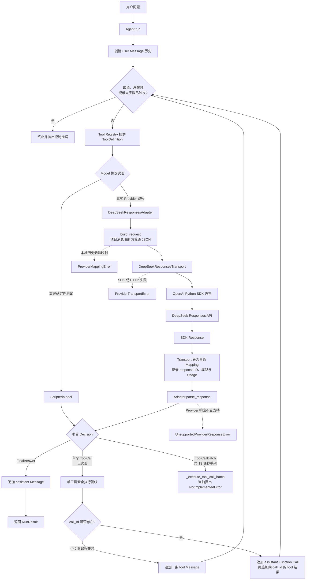
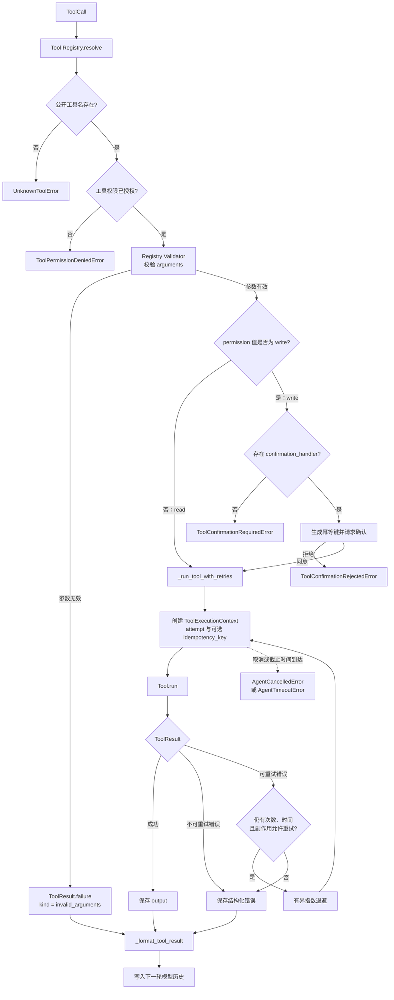
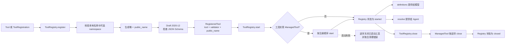

# Agent Lab 项目流程图

> **文档类型**：当前实现的端到端运行视图  
> **已验收范围**：第 1～12 课  
> **当前脚手架**：第 13 课——多个工具调用的顺序与并行策略  
> **最后核验日期**：2026-10-28  
> **导航**：[文档中心](../README.md) · [课程总纲](curriculum.md) · [当前课程](../03-providers/13-parallel-tool-calls.md)

## 1. 如何阅读这份图

这份文档只描述仓库当前实际存在的代码路径，不展示尚未开始的未来架构：

- “已实现”节点已经通过当前课程及此前课程的离线测试；
- “脚手架”节点已经存在类型、测试或 `NotImplementedError`，但不能当作可用能力；
- 完整的未来课序以[系统课程总纲](curriculum.md)为准；
- 每次课程完成验收后，先更新这里，再开始下一课。

当前代码中各层职责：

| 层 | 当前职责 |
| --- | --- |
| 模型 | 根据消息与工具定义提出 `FinalAnswer`、`ToolCall`，或在第 13 课完成后提出 `ToolCallBatch` |
| Agent/Harness | 拥有循环、终止、权限、确认、参数校验、工具执行、重试和历史记录 |
| Adapter | 在项目协议与 DeepSeek Responses API JSON 之间映射，不执行工具 |
| Transport | 拥有 SDK Client、HTTP 超时、Provider 错误映射和 Usage 记录 |
| Tool Registry | 拥有工具公开名称、Schema Validator、解析和生命周期 |
| 工具 | 执行一个经过 Harness 允许的动作并返回 `ToolResult` |
| 外部环境 | DeepSeek API、文件、网络服务或其他真正被工具影响的系统 |

## 2. 全项目端到端主流程



主循环中的关键回路是：

```text
模型决策 → Agent 执行工具 → 写入历史 → 再次请求模型
```

模型只提出动作，Agent/Harness 才拥有执行权。工具结果无论成功还是预期失败，都会作为下一轮模型
输入的一部分；最终回答出现后循环结束。

## 3. Provider 与 Transport 边界

```mermaid
flowchart LR
    HISTORY[项目 Message 历史] --> REQUEST[DeepSeekResponsesAdapter.build_request]
    TOOLS[ToolDefinition 列表] --> CODEC[ProviderToolNameCodec.encode]
    CODEC --> REQUEST

    REQUEST --> PAYLOAD[普通 JSON 兼容 Mapping]
    PAYLOAD --> TRANSPORT[DeepSeekResponsesTransport.create_response]
    TRANSPORT --> CLIENT[OpenAI SDK Client<br/>timeout 明确设置<br/>max_retries 固定为 0]
    CLIENT --> API[DeepSeek Responses API]

    API --> SDK_OBJECT[SDK Response 对象]
    SDK_OBJECT --> DUMP[model_dump mode=json]
    DUMP --> VALIDATE[验证 id、model 与 usage]
    VALIDATE --> RECORD[可选 record_call 回调]
    RECORD --> RESPONSE[普通响应 Mapping]
    RESPONSE --> PARSE[DeepSeekResponsesAdapter.parse_response]

    PARSE --> ANSWER[FinalAnswer]
    PARSE --> CALL[ToolCall<br/>带原始 call_id]
    PARSE --> BATCH[ToolCallBatch<br/>第 13 课解析脚手架]

    CLIENT -. 已知 SDK 或 HTTP 异常 .-> TRANSPORT_ERROR[稳定的 ProviderTransportError 分类]
    VALIDATE -. 响应结构错误 .-> PROTOCOL_ERROR[不可重试的 PROTOCOL 错误]
    REQUEST -. 名称或历史不合法 .-> MAP_ERROR[ProviderMappingError]
```



SDK 类型只存在于 Transport 边界。Adapter、Agent、Registry 和工具只能看到项目自有类型或普通
JSON 兼容数据，因此 Provider SDK 升级不会直接污染核心协议。

第 12 课已经支持单个 Function Call 的双向映射：Provider 的 `call_id` 原样进入 `ToolCall`，工具
执行后再以相同 ID 构造 `function_call_output`。第 13 课的三个待实现入口是：

- `_parse_function_call_batch()`：解析多个调用并拒绝重复 ID；
- `_build_batched_function_call_history()`：重放调用块与结果块；
- `_execute_tool_call_batch()`：整批预检、调度、执行和稳定归并。

## 4. 单工具安全执行管线



参数验证失败不会触达工具。对写工具，确认由 Host 控制，模型不能自行批准；重试还必须考虑
幂等性。`ToolResult.failure(...)` 表示可预期的业务或执行失败，工具直接抛出的未知异常仍会终止
当前 Agent run，不会被伪装成正常观察结果。

## 5. Tool Registry 的装配与生命周期



Registry 的公开名称和生命周期属于 Host，不属于 Provider。Adapter 只编码或解码公开名称，不查询
Registry；Agent 在真正执行前才解析工具并使用 Registry 已准备好的 Validator。

## 6. 课程完成时如何维护

每次课程通过验收后，按下面顺序更新本文件：

1. 把页首“已验收范围”推进到刚完成的课程；
2. 将该课程对应节点从“脚手架”改为已实现路径；
3. 补充新增的成功分支、错误出口、状态回路和外部边界；
4. 删除已不符合当前代码的旧路径，不保留历史实现快照；
5. 核对类名、方法名、异常名、消息顺序与当前代码一致；
6. 更新“最后核验日期”；
7. 检查本页与两个 README、课程总纲和相邻课程之间的链接。

这份图回答“项目现在怎样运行”；课程总纲回答“项目以后向哪里演进”。两者不能互相替代。
